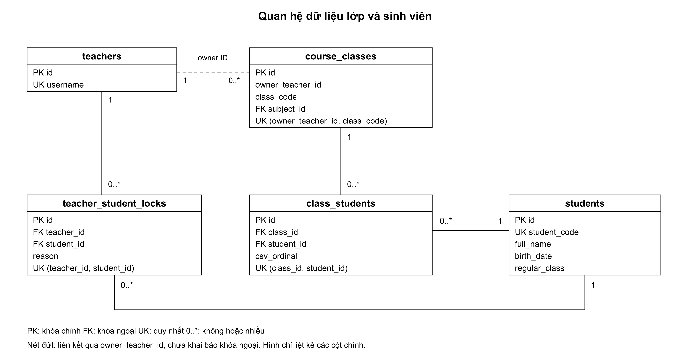
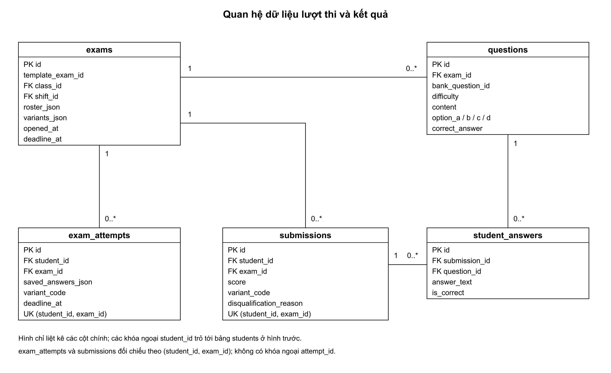
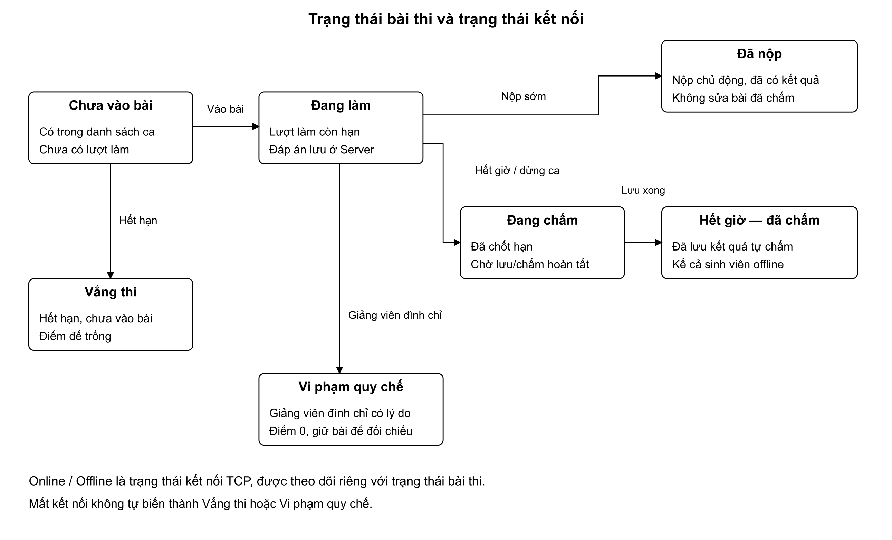

# Dữ liệu lớp và lượt thi

`students` lưu một hồ sơ cho mỗi MSV. `class_students` liên kết sinh viên với lớp học phần và giữ STT lấy từ CSV của lớp đó. Một sinh viên có thể học nhiều lớp; STT không phải vị trí đang hiển thị trong bảng.

Nhập CSV có MSV đã tồn tại sẽ dùng lại hồ sơ đang lưu. Nếu tên, ngày sinh hoặc lớp chính quy khác, xem trước báo khác biệt nhưng không ghi đè hồ sơ chung. Danh sách sinh viên hiện chỉ xem và tìm kiếm. Khóa tài khoản lưu theo cặp giảng viên–sinh viên, không khóa toàn bộ các giảng viên khác.

Nét liền trong hình là quan hệ khóa ngoại. Nét đứt `owner_teacher_id` là ID được kiểm tra ở tầng nghiệp vụ, chưa khai báo quan hệ khóa ngoại JPA. PK là khóa chính, FK là khóa ngoại, UK là ràng buộc duy nhất.

## Đề mẫu và lượt thi

`exams` chứa cả đề mẫu và lượt được mở từ đề mẫu. Lượt có `template_exam_id`, lớp, ca nếu có, danh sách dự thi đã chốt và thời hạn chung. `questions` giữ bản sao nội dung và độ khó; sửa câu trong ngân hàng không đổi đề đã lưu.

Một mã dùng đề **Gốc**; `variants_json` và `variant_code` có thể trống. Từ 2–8 mã lưu bố cục và phân công mã số. Các mã dùng cùng bộ câu và cùng số câu từng mức, chỉ đảo trong từng mức và đảo đáp án phù hợp.

`exam_attempts` giữ lượt đang làm và đáp án đã lưu. `submissions` giữ kết quả cuối, `student_answers` giữ lựa chọn từng câu. Lượt làm và bài nộp được đối chiếu qua cặp `student_id` + `exam_id`; không có khóa ngoại `attempt_id` trong `submissions`.

## Trạng thái và điểm

Kết nối Online/Offline được theo dõi riêng với trạng thái của từng bài. Người đã nộp vẫn có kết quả khi offline; người chưa vào bài chỉ bị ghi vắng sau khi ca kết thúc hoặc hết hạn. Khi đã chốt hạn nhưng còn xử lý/chấm, bảng kết quả có thể hiện **Đang chấm**.

Server chấm theo công thức `điểm = số câu đúng / tổng số câu × 10`, làm tròn hai chữ số thập phân. Các câu có cùng trọng số; mức độ khó không nhân hệ số điểm. Câu sai hoặc bỏ trống không cộng điểm. Bài bị đình chỉ có lý do nhận điểm 0 và giữ bằng chứng; người vắng để trống điểm, không tự tạo bài điểm 0.

Server khởi động lại chỉ phục hồi ca còn hạn và dữ liệu đã lưu, không tự gia hạn. Ca đã chia và từng mở thi không được dùng lại. Với thi cả lớp không chia ca, giảng viên có thể tạo lượt mới từ cùng đề mẫu sau khi lượt trước đã kết thúc và chấm xong; kết quả cũ được giữ riêng.

Luồng hiện hành dùng 15 bảng, gồm cả `exam_shift_students`. Hai ánh xạ `assignment` và `assignment_submissions` chỉ để đọc dữ liệu cũ, không phải chức năng giao bài thực hành trong giao diện hiện tại.
