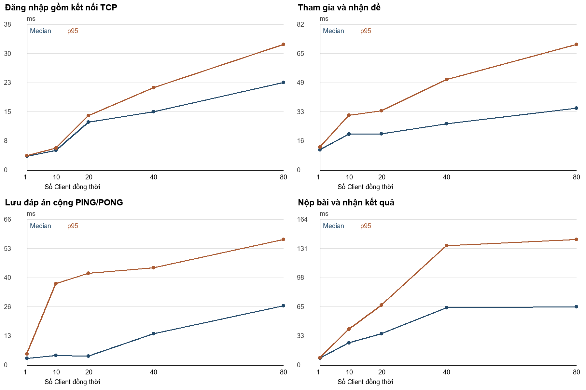
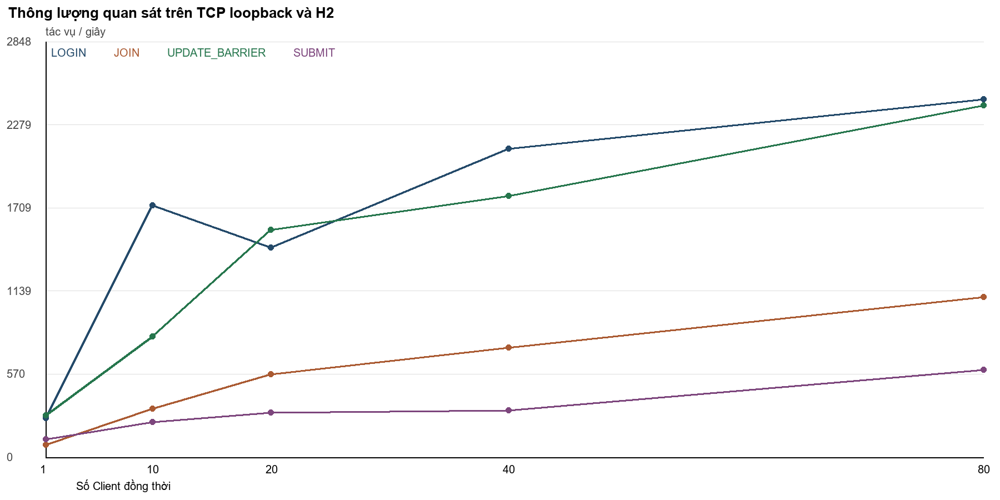

# Kết quả kiểm thử và đo tải

## Kiểm thử chức năng

Log [functional-tests.txt](functional-tests.txt) ghi nhận **142 test: 141 đạt, 1 bỏ qua, 0 thất bại, 0 lỗi**, Maven báo **BUILD SUCCESS**. Toàn bộ lệnh mất **1 phút 43 giây**. Test bỏ qua là `ReportBenchmarkTest` vì tùy chọn đo tải không được bật trong lệnh chạy chức năng; test này đã chạy bằng lệnh riêng.

Lệnh bật giao diện: `mvn "-Dlanexam.uiTests=true" test`. Các test dùng H2 riêng, TCP loopback và JavaFX. Cửa sổ **Other application** được test mở để kiểm tra mất focus, không phải một ứng dụng lạ cần người dùng điều khiển. Thời gian chạy cả lệnh Maven không phải độ trễ của ứng dụng.

## Môi trường đo tải

| Thành phần | Cấu hình đã ghi nhận |
|---|---|
| CPU | Intel Core i7-11800H; 8 nhân vật lý, 16 bộ xử lý logic |
| RAM | Khoảng 15,84 GiB theo hệ điều hành |
| Hệ điều hành | Windows 11 Home |
| Java | JDK 21.0.8, heap tối đa khoảng 3,96 GiB |
| Cơ sở dữ liệu | H2 2.3.232 trong bộ nhớ, MODE=MySQL, pool tối đa 20 |
| Kết nối | TCP 127.0.0.1, cổng tạm; Client và Server cùng JVM |
| Dữ liệu | 80 hồ sơ mẫu; đề 30 câu, 5 câu/mức 1–6; một mã Gốc |
| Tải | 1, 10, 20, 40, 80 Client; 3 lượt/mức; 5 cập nhật/Client |

Bộ đo tạo Client TCP tự động, không mở 80 cửa sổ JavaFX. Lượt làm nóng với 5 Client được loại khỏi thống kê. Sau 5 lần đổi câu đầu giữa B và A, bộ đo đọc lại đáp án cuối B đã lưu; khi nộp gửi toàn bộ đáp án A và kiểm tra điểm 10.

Log [benchmark-log.txt](benchmark-log.txt) ghi **1 test đạt**, không lỗi, thất bại hay bỏ qua; test mất 7,496 giây, toàn bộ lệnh Maven mất 14,070 giây. Dữ liệu có **3.624 thao tác thành công, 0 lỗi và 0 timeout**: 453 LOGIN, 453 JOIN, 2.265 UPDATE_BARRIER và 453 SUBMIT. Đây là số thao tác đo, không phải 3.624 test JUnit.

## Thời gian phản hồi

Mỗi ô là **median / p95**, đơn vị ms.

| Client | LOGIN | JOIN | UPDATE + PING | SUBMIT |
|---:|---:|---:|---:|---:|
| 1 | 3,63 / 3,77 | 11,39 / 12,86 | 3,06 / 5,09 | 7,83 / 8,39 |
| 10 | 5,14 / 5,67 | 20,25 / 30,74 | 4,31 / 37,05 | 24,87 / 40,44 |
| 20 | 12,46 / 14,16 | 20,35 / 33,39 | 4,00 / 41,74 | 35,09 / 67,48 |
| 40 | 15,22 / 21,46 | 26,08 / 50,77 | 14,26 / 44,20 | 64,36 / 134,27 |
| 80 | 22,77 / 32,65 | 34,80 / 70,49 | 27,03 / 57,06 | 65,65 / 141,14 |



LOGIN gồm cả tạo kết nối TCP đến LOGIN_RESULT. JOIN đo từ JOIN_EXAM đến EXAM_STARTED. SUBMIT đo từ SUBMIT_EXAM đến SUBMIT_RESULT. UPDATE_BARRIER gồm gửi ANSWER_UPDATE rồi PING và chờ PONG; FIFO giữ cập nhật trước PING. Đây không phải thời gian ghi database riêng hoặc ACK lưu đáp án trong ứng dụng.

Mỗi loại LOGIN, JOIN và SUBMIT có 3N mẫu ở mức N Client; UPDATE_BARRIER có 15N mẫu. Median là trung vị; p95 dùng nearest rank, lấy mẫu ở vị trí `ceil(0,95 × số mẫu)` khi đánh số từ 1. Mức một Client chỉ có ba mẫu cho các thao tác không lặp, nên p95 cần được đọc thận trọng.

## Thông lượng

Đơn vị: thao tác/giây. Mỗi UPDATE_BARRIER gồm cả cập nhật và PING/PONG.

| Client | LOGIN | JOIN | UPDATE + PING | SUBMIT |
|---:|---:|---:|---:|---:|
| 1 | 267,24 | 85,68 | 287,94 | 123,47 |
| 10 | 1.728,41 | 334,76 | 827,65 | 242,08 |
| 20 | 1.437,23 | 569,27 | 1.558,46 | 304,68 |
| 40 | 2.114,61 | 752,24 | 1.790,69 | 321,54 |
| 80 | 2.455,57 | 1.097,75 | 2.411,95 | 599,49 |



Thông lượng bằng số thao tác thành công chia tổng thời gian trôi qua của ba đợt cùng loại. Không cộng thời gian phản hồi đang chồng lên nhau giữa các Client. Mức 80 cao hơn mức 1, nhưng không tăng đều ở mọi mức: LOGIN tại 20 Client thấp hơn tại 10 Client. Các lượt ngắn và chạy tải tăng dần, nên chưa dùng để kết luận công suất tối đa.

## Dữ liệu để đối chiếu

- [samples.csv](benchmark/samples.csv): từng thao tác và thời gian phản hồi.
- [phases.csv](benchmark/phases.csv): thời gian của từng đợt đo.
- [summary.csv](benchmark/summary.csv) / [summary.json](benchmark/summary.json): thống kê 20 nhóm tải và loại thao tác.
- [environment.json](benchmark/environment.json): Java, heap, cấu hình bộ đo và thời gian gốc.
- [hardware.json](benchmark/hardware.json): CPU, RAM và hệ điều hành.

Các log được chuyển sang UTF-8 và chuẩn hóa xuống dòng, giữ nội dung và thời gian gốc để đối chiếu nguồn. Toàn bộ dữ liệu thuộc cùng lần chạy, không trộn số liệu cũ với biểu đồ mới.

## Chạy lại

Chạy từ thư mục gốc dự án, cần JDK 21 và Maven:

```powershell
mvn "-Dlanexam.build.directory=output/benchmark-build" "-Dtest=ReportBenchmarkTest" "-Dlanexam.benchmark=true" test
python tools/analyze_report_benchmark.py --input-dir output/report-final/experiment
```

Để tính lại trực tiếp từ bản số liệu đã lưu trên GitHub, dùng `python tools/analyze_report_benchmark.py --input-dir statics/results/benchmark`. Script cần Python và Pillow; tạo summary cùng biểu đồ trong thư mục được chọn. Biểu đồ đi kèm bản nộp đang nằm ở thư mục này.

Chưa đo MySQL trên nhiều máy LAN, không có kết quả chạy liên tục nhiều giờ hoặc thu CPU/RAM theo thời gian. H2 trong bộ nhớ không phản ánh chi phí ghi MySQL xuống đĩa. Các bước đo tiếp theo nằm trong [kế hoạch thực nghiệm](EXPERIMENT_PLAN.md).
